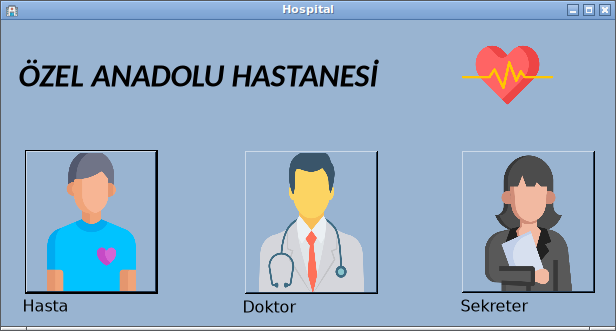
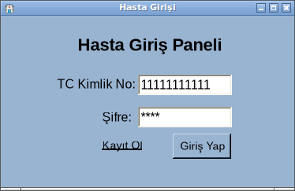
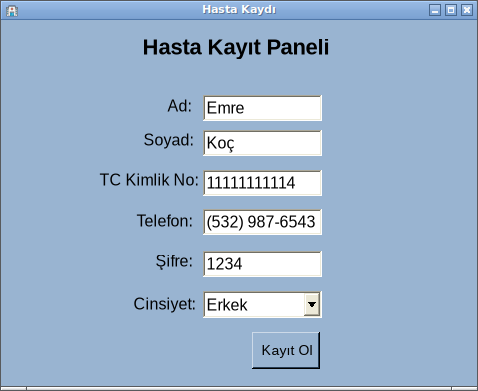
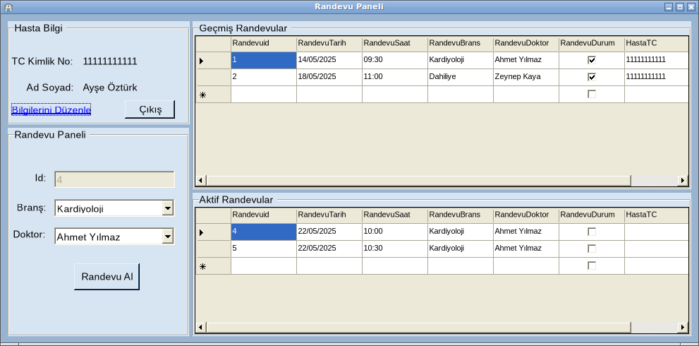
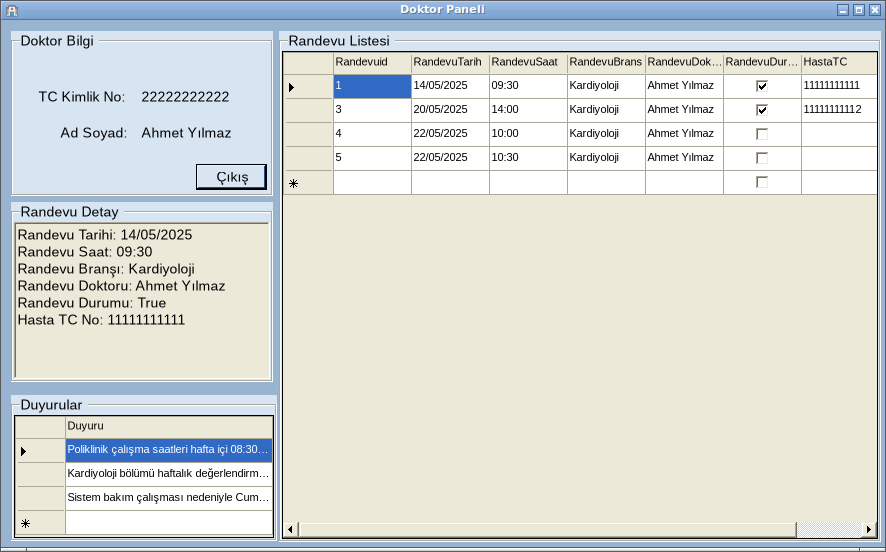
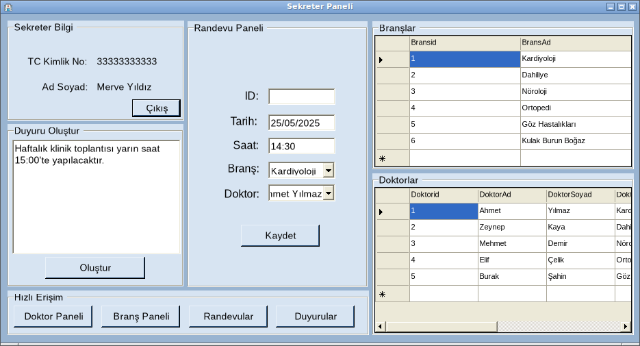
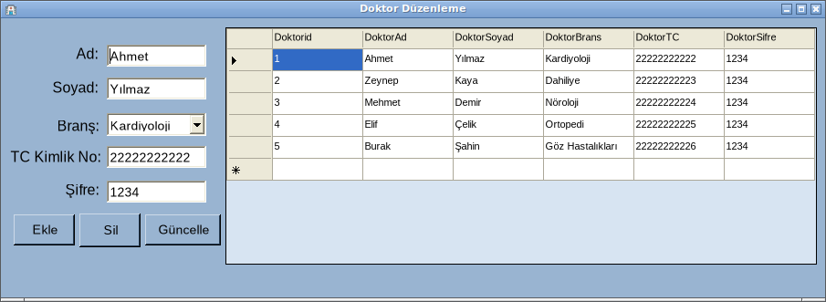
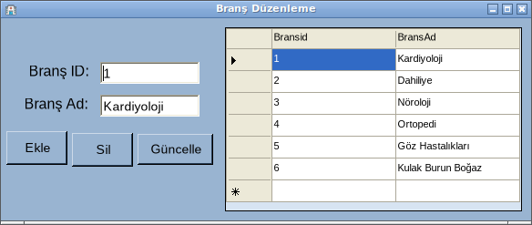

# Hastane Yönetim Sistemi

C# Windows Forms ve Microsoft SQL Server (ADO.NET) kullanılarak geliştirilmiş masaüstü hastane randevu ve yönetim otomasyonudur. Uygulama; hasta, doktor ve sekreter rolleri için ayrı giriş ve yönetim panelleri sunar.

## Özellikler

### Hasta Modülü
- Yeni hasta kaydı oluşturma ve TC kimlik numarası / şifre ile giriş yapma
- Kişisel iletişim ve şifre bilgilerini güncelleme
- Branş ve doktor filtreleyerek aktif (müsait) randevuları görüntüleme ve randevu alma
- Geçmiş randevuları listeleme

### Doktor Modülü
- TC kimlik numarası ve şifre ile giriş yapma
- Kendine atanmış randevuları listeleme ve seçilen randevunun detaylarını görüntüleme
- Sekreterlik tarafından yayınlanan hastane duyurularını takip etme

### Sekreter Modülü
- Yeni randevu kaydı oluşturma ve tüm randevuları listeleme
- Doktor ekleme, güncelleme ve silme (`Doktor Paneli`)
- Branş ekleme, güncelleme ve silme (`Branş Paneli`)
- Duyuru oluşturma ve mevcut duyuruları görüntüleme

## Kullanılan Teknolojiler

- **Dil:** C#
- **Platform:** .NET Framework 4.7.2 (Windows Forms)
- **Veri Erişimi:** ADO.NET (`System.Data.SqlClient`)
- **Veritabanı:** Microsoft SQL Server
- **IDE:** Visual Studio

## Proje Yapısı

```text
hospital_management_system/
├── database/
│   └── HastaneProje.sql              # Veritabanı şeması ve örnek test verileri
├── hastane_yonetim_sistemi/
│   ├── App.config.example            # Örnek bağlantı yapılandırması
│   ├── SqlBaglanti.cs                # Veritabanı bağlantı sınıfı
│   ├── HastaneGiris.cs               # Ana rol seçim ekranı
│   ├── FrmHasta*.cs                  # Hasta giriş, kayıt, detay ve bilgi düzenleme formları
│   ├── FrmDoktor*.cs                 # Doktor giriş, detay ve yönetim formları
│   ├── FrmSekreter*.cs               # Sekreter giriş ve yönetim paneli formları
│   ├── FrmBransPanel.cs              # Branş CRUD formu
│   ├── FrmRandevular.cs              # Randevu listesi formu
│   └── FrmDuyurular.cs               # Duyurular formu
├── screenshots/                      # Uygulama ekran görüntüleri
└── hastane_yonetim_sistemi.sln
```

## Veritabanı Şeması

Uygulama `HastaneProje` veritabanı altında 6 tablo kullanır:

| Tablo | Açıklama |
| --- | --- |
| `Tbl_Hastalar` | Hasta kimlik, iletişim, cinsiyet ve giriş bilgileri |
| `Tbl_Doktorlar` | Doktor bilgileri, bağlı oldukları branş ve giriş bilgileri |
| `Tbl_Sekreter` | Sekreter yetkili giriş ve profil bilgileri |
| `Tbl_Branslar` | Hastane poliklinik / branş tanımları |
| `Tbl_Randevular` | Randevu tarih, saat, branş, doktor, durum ve hasta eşleşmeleri |
| `Tbl_Duyurular` | Sekreterlik tarafından yayınlanan hastane duyuruları |

## Kurulum ve Çalıştırma

### Gereksinimler
- Windows işletim sistemi
- Visual Studio 2019 veya 2022 (**.NET masaüstü geliştirme** iş yükü ve **.NET Framework 4.7.2** hedefleme paketi)
- Microsoft SQL Server (SQL Server Express veya LocalDB)

### 1. Veritabanı Kurulumu
1. SQL Server Management Studio (SSMS) üzerinden SQL Server örneğinize bağlanın.
2. `database/HastaneProje.sql` dosyasını açıp çalıştırın. Bu script `HastaneProje` veritabanını, 6 tabloyu (`Tbl_Branslar`, `Tbl_Doktorlar`, `Tbl_Hastalar`, `Tbl_Sekreter`, `Tbl_Randevular`, `Tbl_Duyurular`) ve örnek test verilerini oluşturur.

Alternatif olarak komut satırından `sqlcmd` ile de kurabilirsiniz:
```bash
sqlcmd -S .\SQLEXPRESS -E -i database\HastaneProje.sql
```

### 2. Bağlantı Yapılandırması
1. `hastane_yonetim_sistemi/App.config.example` dosyasını kopyalayarak aynı klasörde `App.config` adıyla kaydedin.
2. `App.config` içindeki `HastaneDb` bağlantı dizesini kendi SQL Server sunucu adınızdaki ayarlara göre düzenleyin:

```xml
<connectionStrings>
    <add name="HastaneDb"
         connectionString="Data Source=.\SQLEXPRESS;Initial Catalog=HastaneProje;Integrated Security=True;"
         providerName="System.Data.SqlClient" />
</connectionStrings>
```

> Not: `hastane_yonetim_sistemi/App.config` dosyası yerel bağlantı bilgilerini korumak amacıyla `.gitignore` kapsamındadır.

### 3. Visual Studio ile Derleme ve Çalıştırma
1. `hastane_yonetim_sistemi.sln` dosyasını Visual Studio ile açın.
2. Çözümü derleyin (`Build > Build Solution` veya `Ctrl + Shift + B`).
3. Uygulamayı başlatın (`F5`).

### Örnek Giriş Bilgileri
`database/HastaneProje.sql` scripti çalıştırıldığında aşağıdaki demo hesaplarla doğrudan test edilebilir:

| Rol | TC Kimlik No | Şifre |
| --- | --- | --- |
| Hasta | `11111111111` | `1234` |
| Doktor | `22222222222` | `1234` |
| Sekreter | `33333333333` | `1234` |

## Ekran Görüntüleri

### Ana Giriş Ekranı


### Hasta Giriş ve Kayıt




### Hasta Randevu Paneli


### Doktor Paneli


### Sekreter Paneli


### Doktor ve Branş Yönetimi



